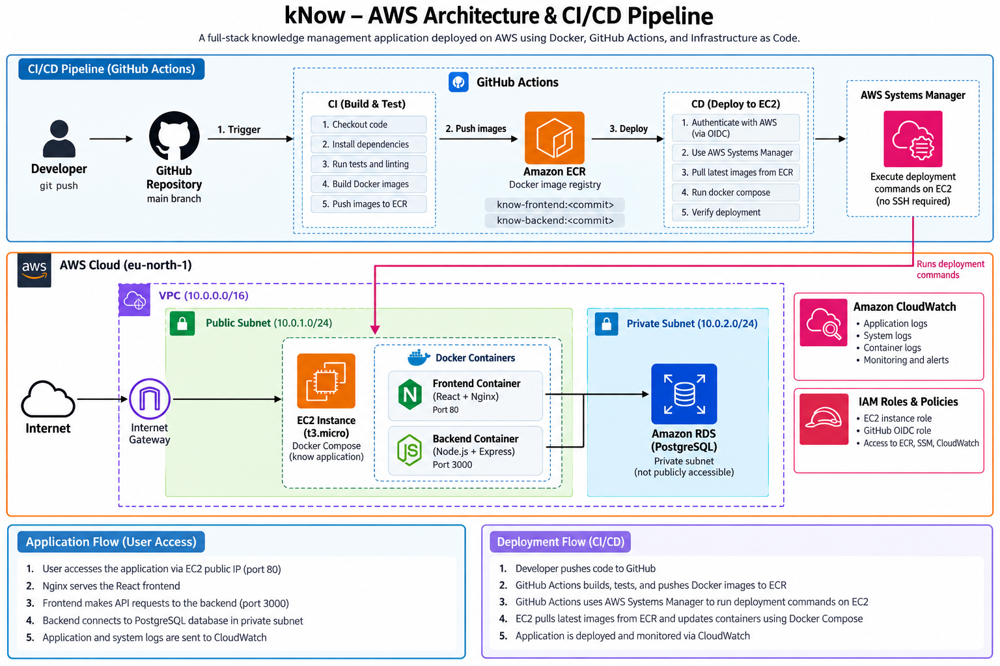

# kNow — AWS DevOps Deployment

**Capture curiosity.**

kNow is a personal knowledge management application for capturing what you learn, organizing knowledge into collections, and keeping track of topics you want to research later. This repository also demonstrates the deployment and operation of a full-stack application on AWS using Infrastructure as Code, containers, and CI/CD.

## Application features

- User authentication and private knowledge entries
- Create, edit, and delete knowledge
- Research Later queue and conversion of completed research into knowledge
- Collections and tags
- Dashboard with learning statistics and weekly goals

## Technology stack

| Area | Technologies |
| --- | --- |
| Frontend | React, Vite, Tailwind CSS, Lucide React, Nginx |
| Backend | Node.js, Express, JWT, bcrypt |
| Database | PostgreSQL on Amazon RDS |
| Infrastructure as Code | Terraform |
| Containers | Docker, Docker Compose |
| CI/CD | GitHub Actions |
| Container registry | Amazon ECR |
| Compute and networking | Amazon EC2, VPC, public and private subnets, security groups |
| Deployment | AWS Systems Manager (SSM) |
| Authentication and permissions | AWS IAM, GitHub OpenID Connect (OIDC) |
| Monitoring | Amazon CloudWatch Logs, CloudWatch alarm, Amazon SNS |
| Provisioning tooling | Ansible (Docker installation playbook) |

## Architecture



The production environment runs in the AWS `eu-north-1` region.

```text
Internet
   |
   v
AWS VPC (10.0.0.0/16)
   |
   +-- Public subnet (10.0.1.0/24)
   |      |
   |      +-- EC2 (Docker Compose)
   |             +-- Nginx + React frontend (HTTP :80)
   |             +-- Node.js / Express backend (:3000, internal)
   |
   +-- Private subnets (10.0.2.0/24, 10.0.3.0/24)
          |
          +-- Amazon RDS for PostgreSQL
```

The backend accesses PostgreSQL over the VPC network. The database is not publicly accessible, and its security group allows database traffic from the EC2 security group.

## Infrastructure as Code

Terraform configuration lives in [`terraform/`](terraform/). It defines:

- VPC, internet gateway, public and private subnets, and routing
- EC2 instance and security groups
- Private Amazon RDS PostgreSQL database
- Amazon ECR repositories for frontend and backend images
- IAM roles and permissions for EC2 and GitHub Actions
- GitHub OIDC integration for temporary AWS credentials

Terraform state and environment secrets are **not** committed to the repository.

## Containerization

The frontend and backend run as separate Docker containers. The production configuration is in [`docker-compose.prod.yml`](docker-compose.prod.yml).

- Frontend: React application served by Nginx on port 80
- Backend: Node.js/Express API on the internal Docker network
- Database: Managed PostgreSQL on Amazon RDS, outside the containers
- Backend logs: Docker `awslogs` driver sends container output to CloudWatch Logs

## CI/CD pipeline

GitHub Actions workflows are stored in [`.github/workflows/`](.github/workflows/).

1. A push to `main` triggers **kNow CI**.
2. CI runs application checks and builds frontend and backend Docker images.
3. The images are tagged with the Git commit SHA and pushed to Amazon ECR.
4. A successful CI run triggers **kNow CD**.
5. CD assumes an AWS IAM role using GitHub OIDC and sends deployment commands through AWS Systems Manager.
6. On EC2, the deployment checks out the matching commit, pulls images from ECR, and updates containers with Docker Compose.

This design avoids storing long-lived AWS access keys in GitHub Actions and does not require SSH access from the CI/CD runner.

## Security

- PostgreSQL runs in private subnets and is not publicly accessible.
- Security groups restrict database access to the application EC2 instance.
- GitHub Actions uses OIDC and temporary AWS credentials.
- EC2 uses an instance IAM role for ECR pulls, SSM, and CloudWatch Logs.
- Production environment variables and database credentials are kept outside Git.

## Monitoring and alerting

- Backend container logs are sent to CloudWatch log group `/know/backend`.
- A CloudWatch alarm monitors EC2 CPU utilization.
- Amazon SNS delivers alarm notifications by email.

## Troubleshooting experience

**EC2 disk space:** An SSM deployment failed with `no space left on device`. I inspected filesystem and Docker storage usage, cleaned unused Docker data, increased the root EBS volume through Terraform, and expanded the Ubuntu filesystem.

**Git repository ownership:** An SSM deployment failed because commands ran as `root` while the repository belonged to `ubuntu`. I updated the workflow to run Git commands as the repository owner.

**Missing CloudWatch logs:** The log group existed but had no streams. Inspecting the container revealed the `json-file` logging driver was still active. I updated the deployed Compose configuration and recreated the backend container with `awslogs`.

## Repository structure

```text
.github/workflows/       GitHub Actions CI/CD workflows
terraform/               AWS infrastructure definitions
ansible/                 Configuration management playbooks
server/                  Node.js backend
src/                     React frontend
nginx/                   Nginx configuration
docker-compose.yml       Local Docker Compose setup
docker-compose.prod.yml  Production container configuration
Dockerfile               Frontend image definition
README.md                Project overview and deployment documentation
```

## Local development

The application includes a local Docker Compose configuration in [`docker-compose.yml`](docker-compose.yml). Review that file and the application configuration for the environment variables required to run it locally.

## Deployment status

This repository documents an AWS deployment built as a DevOps portfolio project. Cloud resources may be stopped or destroyed when not in use to avoid ongoing costs.
